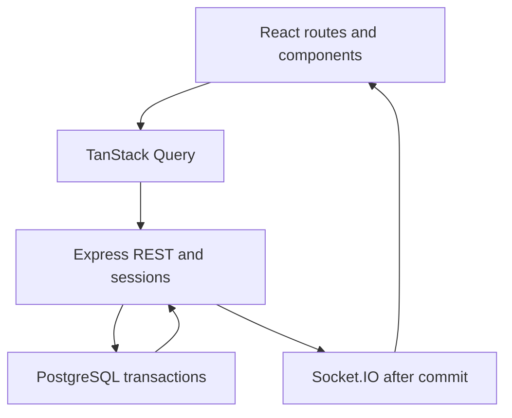

# CampusFix final architecture

CampusFix tracks synthetic campus maintenance reports across student, coordinator and technician roles. It is one React application, one Express server and one PostgreSQL database.

REST owns reads and mutations. M4 workflow services enforce role/ownership, state transitions, expected versions, row locks and atomic history. Neither React controls nor a socket message can authorize a mutation. SQL migrations 001 and 002 remain unchanged; no 003 is required because notifications are ephemeral.

The HTTP server serves Vite assets and hosts Socket.IO at the same origin. Browser cookie sessions, Origin and CSRF behavior are retained. Socket handshakes require the same session cookie and CSRF token. The server reauthenticates before delivery and periodically while idle. Clients cannot choose rooms. Only the reporter, coordinator and assigned technician receive compact requestId/version/action hints. No description, note, password or student identity travels in a change event.

On a committed REST action, an optional publisher sends change hints. Publication failure is logged with a safe event name and does not undo or misreport the committed write. No transactional outbox exists: process crash between commit and emission can lose a notification. A fresh connection invalidates caches and refetches authoritative REST state; missed notification history is not restored. Deploying multiple server processes would require additional coordination and is outside this portfolio scope.

Context owns authentication/UI session state. TanStack Query owns fetched lists/details/history/directory and mutation lifecycle. HashRouter retains existing #/ URLs. Local state owns filters, notes, selection, confirmation and notification visibility. Page components compose shared UI; backend services remain separate from HTTP routing.

Private query keys include the current user scope. Session changes cancel/clear cached queries; mutation success guards against a changed scope before caching a newly created record. No browser credential storage is used. The client never optimistically assigns, resolves or closes a request.
