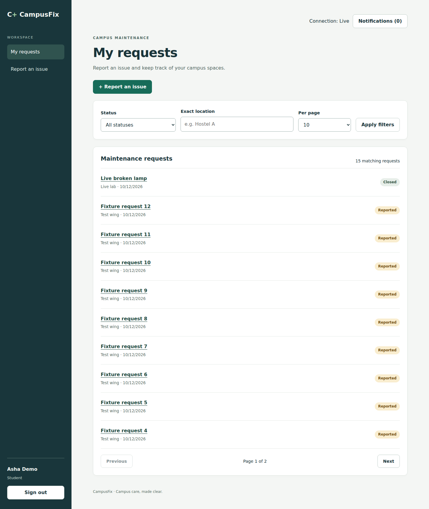

# CampusFix — campus maintenance workflows

CampusFix gives students a clear place to report maintenance issues and follow their progress. Coordinators triage reports and assign technicians; assigned technicians resolve work; reporting students can reopen or confirm closure. Synthetic data only. This independent portfolio project demonstrates TypeScript backend engineering, PostgreSQL transaction correctness and authenticated real-time networking for graduate engineering interviews. The existing React interface is preserved.



## Features

- Reusable React/TypeScript components, controlled forms, accessible states, responsive navigation/cards and confirmation dialogs.
- React Router hash routes and protected screens with cookie-session restoration.
- TanStack Query REST fetching, user-scoped cache keys, mutation lifecycle, targeted invalidation and conflict refresh.
- Socket.IO live updates for authorized users, ephemeral notifications, unread indicator, connection status, bounded reconnect and missed-state recovery.
- Preserved PostgreSQL row locking, expected-version conflicts, transactional audit events and all M1–M4 roles/workflows.
- Automated backend, React, actual socket and independent-browser-context tests; four viewport checks and axe accessibility scans.

## Stack

React 19, TypeScript strict, JavaScript ES6+, HTML5/CSS3, Vite, React Router 7.18.4, TanStack Query 5.104.2, Socket.IO/server-client 4.8.4, Node 24, Express, PostgreSQL 18, Drizzle, Zod, Vitest, React Testing Library, Playwright, axe-core and GitHub Actions. Exact versions are pinned in package.json/lockfile.

## Existing Windows installation

Your working configuration uses PostgreSQL host port **5433**, APP_ORIGIN **http://127.0.0.1:3100**, and the **campusfix** Compose project in the original M2 folder. Preserve its volume and credentials. Follow [Windows instructions](docs/WINDOWS.md). The archive excludes .env. No migration 003 or new database is needed.

```powershell
npm ci
npm run check
npm run lint
npm test
npm run test:frontend
npm run build
npm run doctor
npm start
```

Use existing accounts/passwords. Keep the database container running from its original Compose project. If extracting to a new folder, copy the existing .env privately without overwriting another file; do not run setup or start a new Compose project. The environment example is placeholders for fresh setup only, not replacement credentials.

## Reproducible disposable verification

Use Node 24 and Docker with Compose v2. These commands create only a unique,
temporary PostgreSQL test container; they do not load `.env` or use development
volumes.

```bash
node scripts/verify-disposable.mjs --prerequisites
npm ci
npx playwright install --with-deps chromium
npm run verify:disposable -- --skip-install --skip-browser-install
```

Windows PowerShell: use `npx playwright install chromium` instead. WSL2 uses the
Linux commands with Docker Desktop integration enabled. See
[verification commands and cleanup](docs/THALES_VERIFY.md).

[Fresh test report](docs/THALES_REPORT.md) ·
[request and transaction diagrams](docs/THALES_FLOWS.md) ·
[HTTP, Socket.IO and reconnect](docs/THALES_NETWORKING.md) ·
[interview answers](docs/THALES_INTERVIEW.md) ·
[verified resume bullets](THALES_RESUME_BULLETS.md)

## Existing individual test commands

```powershell
npm run test:realtime
npx playwright install chromium
npm run test:e2e
npm run test:e2e:realtime
npm run db:test:prepare
npm run test:integration
npm run test:e2e:native
npm run measure:bundle
npm audit
```

[Historical verification](docs/VERIFICATION.md) records the original milestone. Use [the Thales report](docs/THALES_REPORT.md) for fresh results. Default database tests use embedded PGlite, not native PostgreSQL. Native tests require the separate *_test database and never reset application records. Browser regression/workflow/realtime suites use isolated servers/schemas to preserve production rate limits. See [Testing](docs/TESTING.md).

## Live demonstration

Open student, coordinator and technician sessions in independent browser contexts. Student creates a report: coordinator's list updates. Coordinator triages/assigns: student's timeline and technician's work update. Technician resolves: student sees the resolution without manually refreshing. Student reopens or closes: authorized views update. Disconnect/reconnect restores current REST state; notification history is session-only. Another student receives no private report signal.

## Architecture

[Architecture](ARCHITECTURE.md) · [Frontend](docs/FRONTEND_ARCHITECTURE.md) · [Components](docs/COMPONENTS.md) · [Hooks](docs/REACT_HOOKS.md) · [Socket.IO](docs/REALTIME_ARCHITECTURE.md) · [TanStack Query](docs/TANSTACK_QUERY.md) · [API](docs/API.md) · [Workflow rules](docs/WORKFLOW.md)

Context owns session state; local state owns forms/dialogs; TanStack Query owns server state. REST/PostgreSQL remain authoritative. Socket.IO sends compact change hints only after commit and reauthenticates recipients. No socket mutation, arbitrary room subscription or optimistic assignment can bypass backend permissions.

## Evidence and portfolio

[Accessibility](docs/ACCESSIBILITY.md) · [Performance](docs/PERFORMANCE.md) · [Security](docs/SECURITY.md) · [Changelog](CHANGELOG.md) · [Resume bullets](RESUME_BULLETS.md) · [Interview explanation](docs/INTERVIEW.md)

The bundle grows with the new functionality; lazy workspace loading measurably reduces the final milestone's initial entry. Fresh return navigation is measured separately. No production performance or blanket accessibility certification is claimed.

## Limits

One campus/server/process, synthetic data, no public registration/password reset/uploads/reassignment. Notifications are ephemeral with no outbox/durable delivery. Reconnect restores state, not missed notification history. No public deployment, TLS runtime verification, production load results or team code review is claimed. Actual CI results and local environment limitations are recorded separately in the Thales report. Windows execution remains unverified in this environment. The package declares ISC; the input archive did not include a standalone LICENSE file, and this change preserves that declaration.
