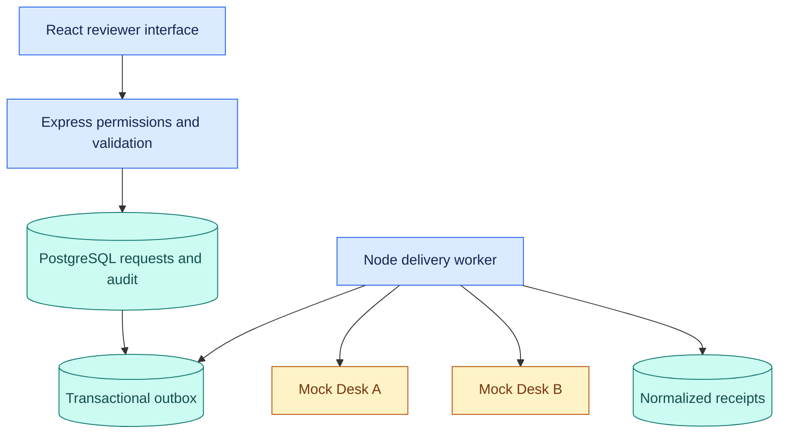
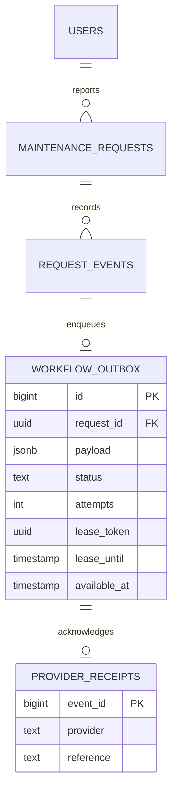
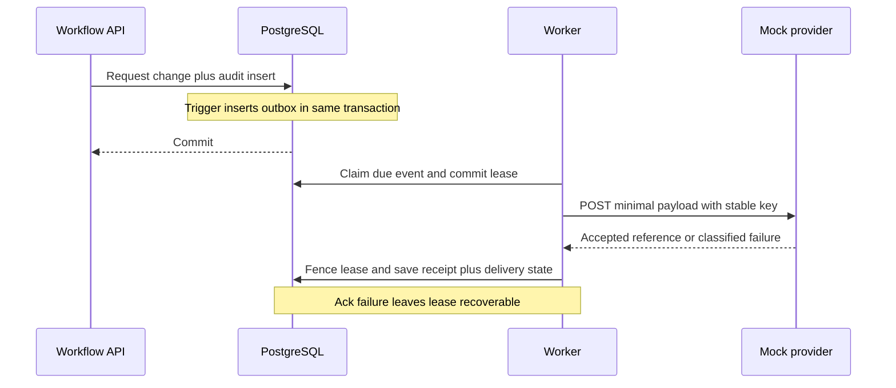
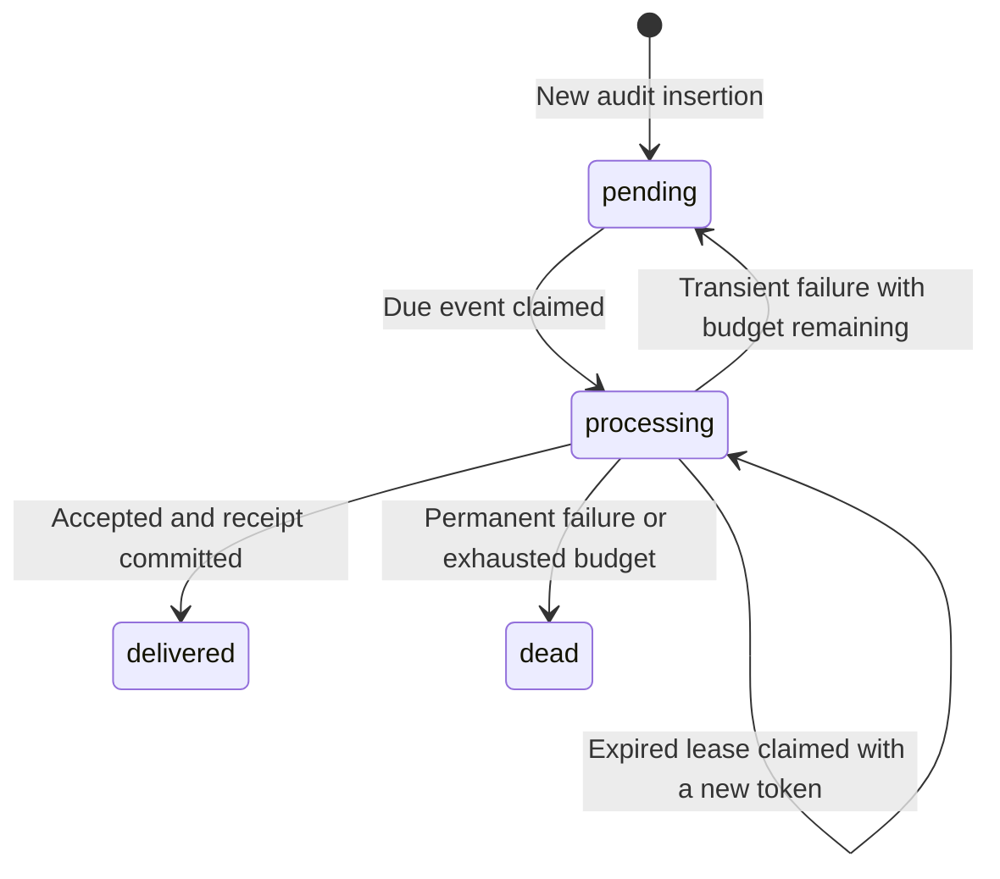
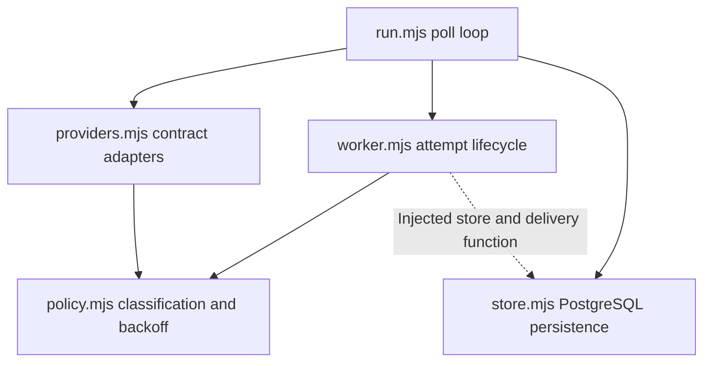

# Durable workflow architecture

## Components and trust boundary

Providers receive only request UUID, action and version. They never receive passwords, session tokens, reporter IDs, descriptions or review notes. URLs are fixed by operator configuration; application users cannot select a destination. Only HTTPS or loopback HTTP is accepted. Redirects are refused. Configuration is trusted; this is not a general SSRF proxy or an enterprise egress-control system.

## Data model

Old audit records do not receive backfilled outbox rows. New inserts are enqueued by the trigger. Audit history is append-only by application convention; a database owner can edit or remove it. No tamper-proof ledger or cryptographic audit integrity is claimed.

## Delivery sequence

No database transaction remains open during HTTP. A worker crash after acceptance and before acknowledgement can cause another request; local uniqueness does not remove this external ambiguity.

## Delivery states

`dead` and `delivered` are terminal for the automatic worker. Worker attempt count is persisted at claim time, so repeated crashes cannot reset the configured budget. A stale claimant's result cannot overwrite the current lease.

## Module dependencies

The worker receives its persistence and delivery functions as dependencies. Local tests exercise its decisions without pretending an in-memory store establishes database correctness. Native integration tests exercise the actual SQL separately.
