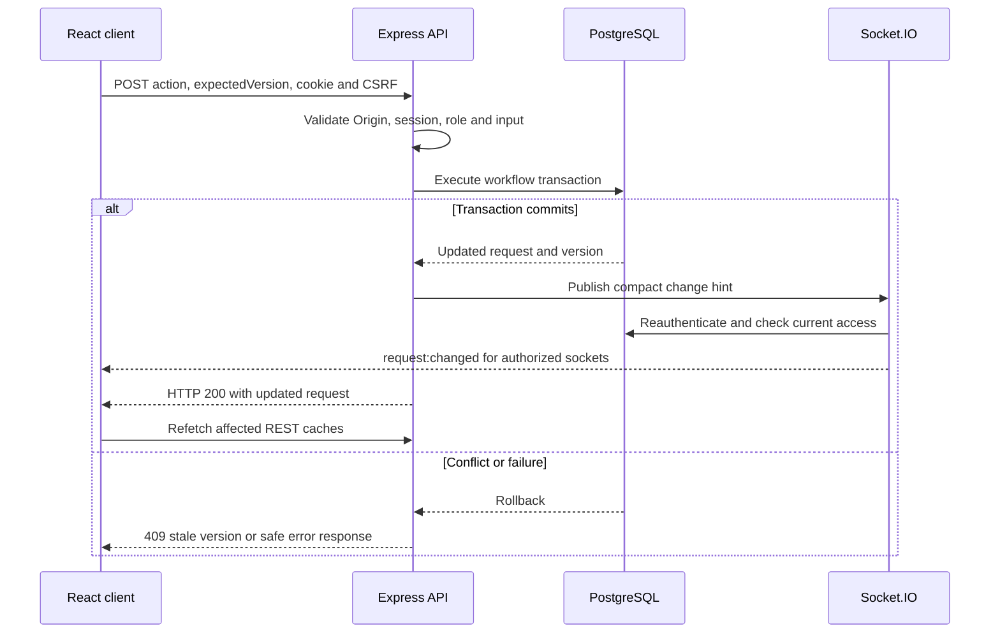
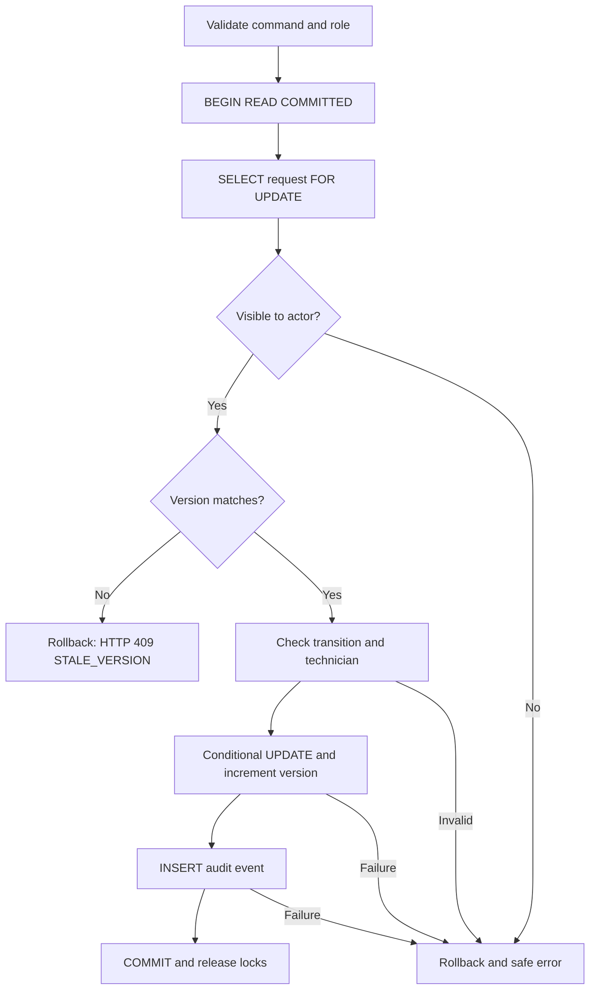

# CampusFix request and transaction flows

These diagrams describe `src/api.ts`, `src/requests/workflow.ts`,
`src/realtime.ts` and `web/src/live.tsx`. PostgreSQL is authoritative.

## HTTP action and live refresh

Publishing occurs after the transaction resolves. A delivery error is logged and
does not undo a committed write. No durable outbox or event replay is implemented.
The HTTP response and socket hint need not reach a browser in a fixed order.

## Workflow transaction

The request row lock lasts until commit or rollback. Assignment also takes a
shared lock on the target technician row while checking its role. A composite
foreign key backs the technician restriction. The request update and audit event
are one atomic unit. A unique request/version audit constraint prevents duplicate
versions. Lists and history use separate repeatable-read, read-only transactions
so their items and total come from one snapshot.

## Controlled concurrency test

Two authenticated coordinators read the same version. A third connection holds
the target request lock while both HTTP actions begin. The test queries
`pg_stat_activity` and `pg_blocking_pids` until it observes two distinct request
backend PIDs waiting on locks, then releases the blocker. One action commits;
the other sees the new version under READ COMMITTED and returns HTTP 409.

The winner is deliberately unspecified. Assertions check its persisted status,
assignee, incremented version and matching audit actor; the loser contributes no
audit row. A separate injected audit-insert failure checks the complete request
row remains unchanged. PGlite skips these native concurrency cases.
